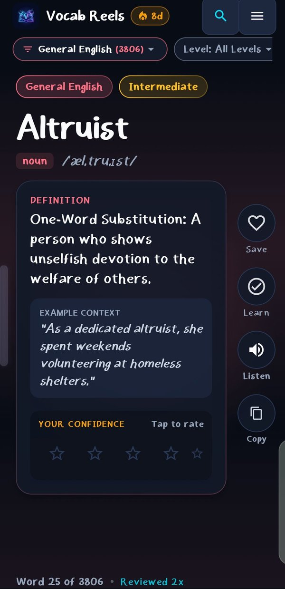
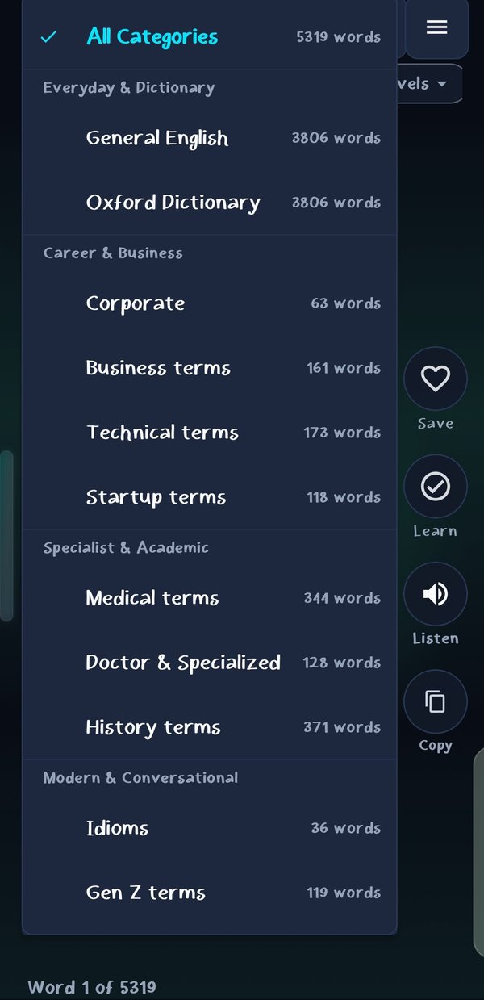
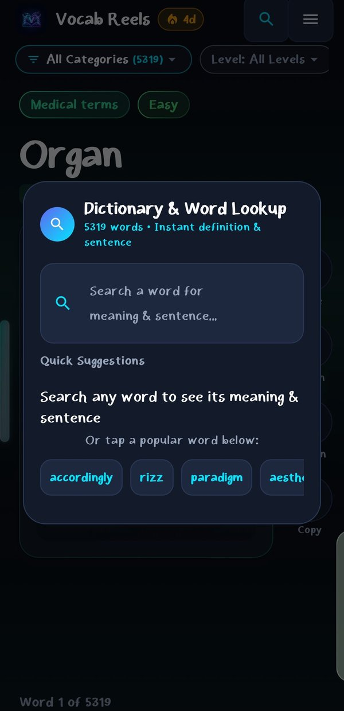
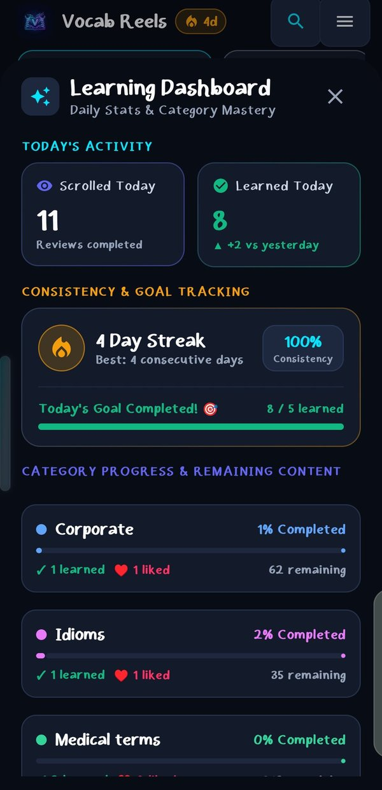
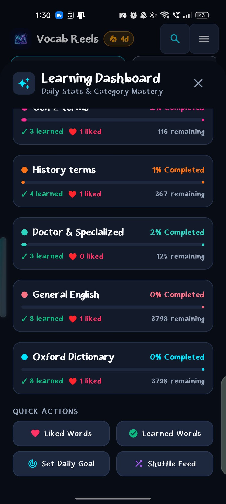

<div align="center">


# 🎬 VocabReels

**Swipe. Learn. Grow.** — master English vocabulary through an addictive, reels-style micro-learning experience.

<p>
  <a href="https://github.com/its-jani/vocab-reels/releases/latest"></a>
  <a href="https://kotlinlang.org/"></a>
  <a href="https://developer.android.com/jetpack/compose"></a>
</p>
<p>
  <a href="https://developer.android.com/training/data-storage/room"></a>
  <a href="https://github.com/its-jani/vocab-reels/releases/latest"></a>
  <a href="https://www.apache.org/licenses/LICENSE-2.0"></a>
</p>

<p>
  <a href="https://github.com/its-jani/vocab-reels/releases/latest">
    
  </a>
</p>

<p>
  <b>5,319</b> words onboard &nbsp;·&nbsp;
  <b>11</b> curated lists &nbsp;·&nbsp;
  <b>3</b> difficulty levels &nbsp;·&nbsp;
  <b>100%</b> offline &nbsp;·&nbsp;
  <b>0</b> ads &amp; trackers
</p>

<p>
  <sub>
    <a href="#overview">Overview</a> &nbsp;·&nbsp;
    <a href="#showcase">App Showcase</a> &nbsp;·&nbsp;
    <a href="#download">Download</a> &nbsp;·&nbsp;
    <a href="#tech-stack">Tech Stack</a> &nbsp;·&nbsp;
    <a href="#build">Build from Source</a> &nbsp;·&nbsp;
    <a href="#contributing">Contributing</a>
  </sub>
</p>

</div>

---

<a name="overview"></a>
## 📌 Overview

**VocabReels** replaces mindless scrolling with effortless learning. Instead of boring flashcard decks or bulky dictionary apps, it wraps **5,319 words** in the addictive vertical swipe of short-form video reels.

Swipe through beautifully designed word cards, tap to hear crystal-clear pronunciations, look up any word instantly, and let the streak-based dashboard keep you coming back every day. No login. No internet. No excuses.

---

<a name="showcase"></a>
## 📱 App Showcase

### 🎞️ Reels-Style Word Cards

The core loop — a full-screen, swipeable feed of word cards
that feels just like your favorite shorts app.

- Word, phonetics, part of speech, definition & a real-world example on every card
- One tap to hear crystal-clear TTS pronunciation
- Save ♥, mark as learned ✓, or copy any word from the action rail
- Rate your confidence 1–5★ and watch mastery grow

<div align="center">
  <a href="screenshots/01_word_card.jpg">
    
  </a>
  <br />
  <sub>The reel — word, definition, example &amp; confidence</sub>
</div>

### 🗂️ Multi-Category Study

**11 curated lists — 5,319 words** — grouped so you always study
exactly what you need.

- *Everyday & Dictionary · Career & Business · Specialist & Academic · Modern & Conversational*
- From Gen Z slang to medical, business & startup jargon
- Filter the feed by difficulty — Easy, Intermediate or Hard
- Pre-packaged database: every list works fully offline

<div align="center">
  <a href="screenshots/02_categories.jpg">
    
  </a>
  <br />
  <sub>Grouped picker — 11 lists, 5,319 words</sub>
</div>

### 🔍 Instant Dictionary Lookup

Search any of the 5,319 words for its meaning and an example
sentence — without leaving the feed.

- One-tap lookup: meaning + sentence, instantly
- Popular-word suggestions to get you started
- Opens right over the reel — no digging through decks

<div align="center">
  <a href="screenshots/03_lookup.jpg">
    
  </a>
  <br />
  <sub>Instant lookup, right over the feed</sub>
</div>

### 🔥 Progress, Streaks & Daily Goals

A learning dashboard engineered to keep the habit alive.

- Set a daily word goal and watch the progress bar fill up
- Streak tracking with best-streak memory & a consistency score
- Scrolled vs. learned stats, compared against yesterday
- Satisfying *“Today’s Goal Completed! 🎯”* moments that build the habit

<div align="center">
  <a href="screenshots/04_dashboard.jpg">
    
  </a>
  <br />
  <sub>Streaks, goals &amp; consistency</sub>
</div>

### 📊 Category Progress & Quick Actions

See exactly how far you’ve come — and jump straight back in.

- Per-category completion bars with learned ✓ / liked ♥ counts
- One-tap quick actions: Liked Words, Learned Words, Set Daily Goal, Shuffle Feed
- Shuffle the deck for a brand-new session, every time

<div align="center">
  <a href="screenshots/05_dashboard_progress.jpg">
    
  </a>
  <br />
  <sub>Category mastery &amp; quick actions</sub>
</div>

### ✨ More Highlights

- 🔊 **Native pronunciation** — instant text-to-speech for every word and example sentence
- 📚 **Bring your own words** — import &amp; export custom word lists as JSON
- ⚡ **Truly offline-first** — the entire dictionary ships inside the APK
- 🎨 **Material 3 dark theme** — glassmorphism accents &amp; high-contrast typography
- 🆓 **Free forever** — no account, no ads, no paywall

---

<a name="download"></a>
## 🚀 Download & Installation

You can install the app on any Android **7.0+** device directly from the repository's **Releases** section:

### 👉 **[Download the Latest VocabReels APK](https://github.com/its-jani/vocab-reels/releases/latest)**

<details>
<summary><b>📲 Step-by-step installation guide</b></summary>

<br/>

1. **Download APK** — tap the green **Download Latest APK** button above (or open the [Releases](https://github.com/its-jani/vocab-reels) tab and download `VocabReels-v*.apk` under **Assets**).
2. **Open File** — when the download finishes, tap the downloaded file in your browser's download manager or from your device's **Files / Downloads** folder.
3. **Allow Installation** — if prompted with *"For your security, your phone is not allowed to install unknown apps from this source"*, tap **Settings** and toggle **Allow from this source** to ON.
4. **Install & Launch** — tap **Install**. Once finished, tap **Open** to start mastering words!

</details>

---

<a name="tech-stack"></a>
## 🛠️ Tech Stack

| Layer | Technology |
| :--- | :--- |
| **Architecture** | Modern Android MVVM · single-activity · 100% Kotlin |
| **UI** | [Jetpack Compose](https://developer.android.com/jetpack/compose) & Material 3 (dark theme) |
| **Language** | Kotlin 2.2 with Coroutines & Flow |
| **Persistence** | [Room](https://developer.android.com/training/data-storage/room) + SQLite — pre-packaged, offline-first |
| **Audio** | Android TextToSpeech engine |
| **Build** | Gradle version catalogs · KSP · Secrets plugin |
| **CI/CD** | GitHub Actions — build validation & automated APK releases |

> 🤖 **AI-ready scaffold**: [Firebase AI (Gemini)](https://firebase.google.com/docs/ai), Retrofit, OkHttp & Moshi are already wired into the Gradle build for upcoming AI-powered features — no key or internet needed to build and run the app as-is.

---

<a name="build"></a>
## 💻 Building from Source (For Developers)

<details>
<summary><b>Expand for build instructions</b></summary>

<br/>

### Prerequisites
- [Android Studio Ladybug (2024.2+) or newer](https://developer.android.com/studio)
- JDK 17 or newer
- Android SDK Platform 36

### 1. Clone the repository
```bash
git clone https://github.com/its-jani/vocab-reels.git
cd vocab-reels
```

### 2. Configure the Gemini API key *(optional)*
Only needed if you plan to enable AI-powered features — the app builds and runs fully offline without it:
```bash
cp .env.example .env
```
Open `.env`, uncomment `GEMINI_API_KEY`, and add your key from [Google AI Studio](https://aistudio.google.com/app/apikey).

### 3. Build & Run
- **Build Debug APK:**
  ```bash
  ./gradlew assembleDebug
  ```
  *Output APK location:* `app/build/outputs/apk/debug/app-debug.apk`

- **Build Release APK:**
  ```bash
  ./gradlew assembleRelease
  ```
  *Output APK location:* `app/build/outputs/apk/release/app-release.apk`

- **Run on Connected Device / Emulator:**
  ```bash
  ./gradlew installDebug
  ```

</details>

---

## 📦 Automated Releases via GitHub Actions

This repository includes automated CI/CD workflows:
- **Build Validation (`build.yml`)**: compiles and tests every push and pull request to `main`.
- **Release Automation (`release.yml`)**: whenever a Git tag matching `v*` (e.g. `v1.0.0`) is pushed, GitHub Actions automatically builds the optimized release APK and publishes a new **GitHub Release** with the APK asset ready for direct download.

To publish a new release:
```bash
git tag v1.0.0
git push origin v1.0.0
```

---

<a name="contributing"></a>
## 🤝 Contributing

Contributions, feature suggestions, and bug reports are welcome!
1. Fork the Project
2. Create your Feature Branch (`git checkout -b feature/AmazingFeature`)
3. Commit your Changes (`git commit -m 'Add some AmazingFeature'`)
4. Push to the Branch (`git push origin feature/AmazingFeature`)
5. Open a Pull Request

---

## 📄 License

Distributed under the **Apache 2.0 License** — see the [license text](https://www.apache.org/licenses/LICENSE-2.0) for more information.
